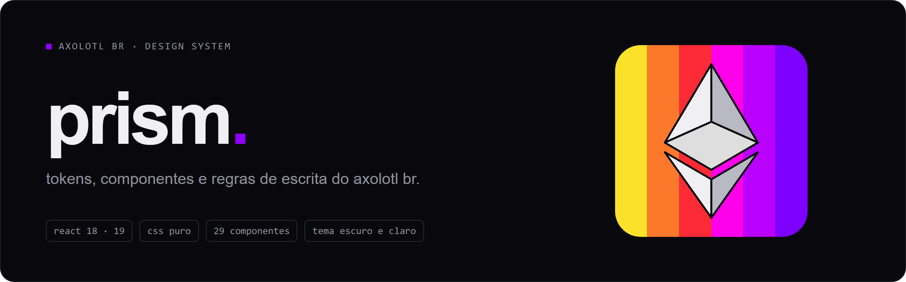
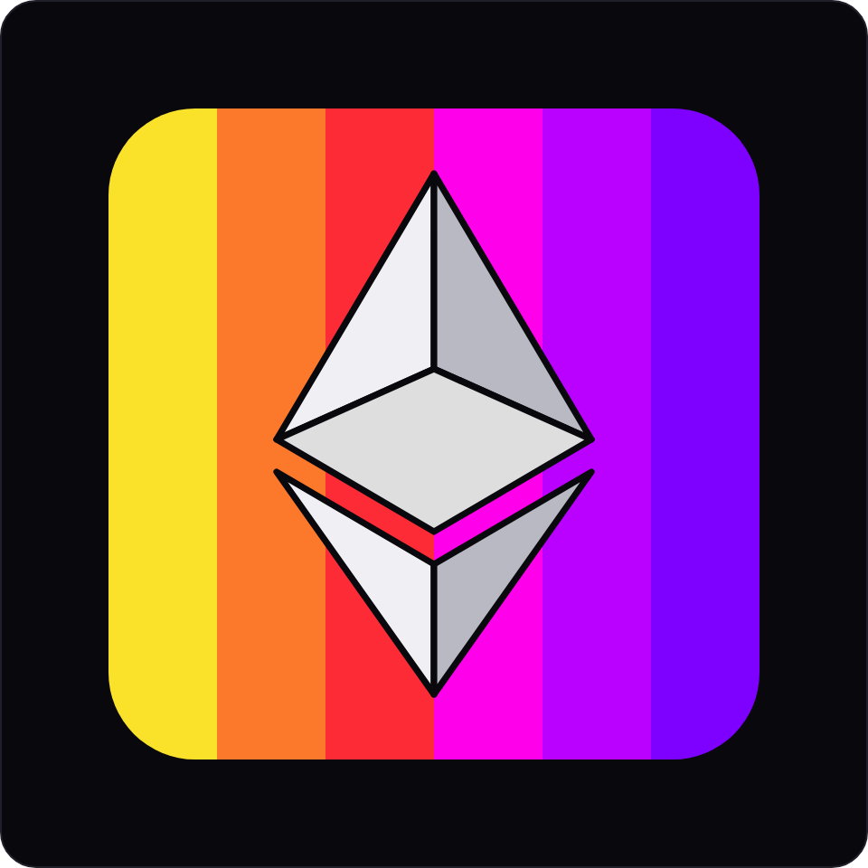
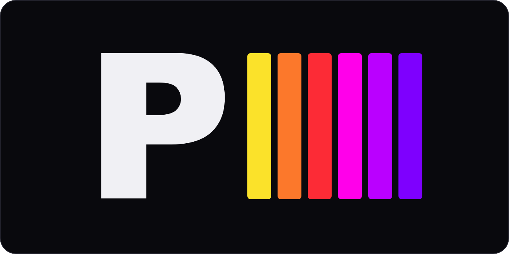
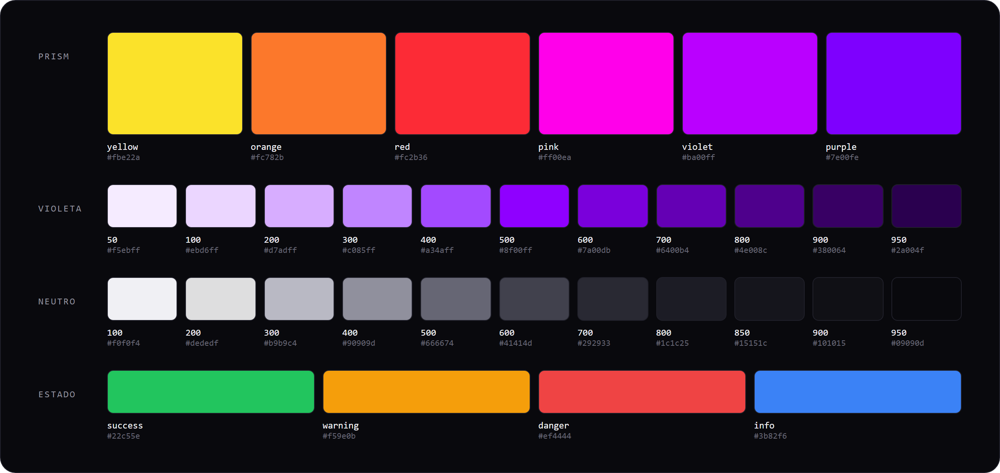

<p align="center">
  
</p>

Prism é a camada visual e de escrita de todos os projetos do Axolotl BR. Um pacote React
com tokens, primitives e componentes, mais as regras de layout e de texto que toda tela
segue. A identidade (violeta `#8F00FF`, fundo escuro, Inter + JetBrains Mono) vivia
espalhada em cada projeto. Agora ela mora aqui.

## Usar

O pacote é distribuído como tarball dentro do projeto que consome:

```json
"dependencies": { "prism": "file:vendor/prism-1.1.0.tgz" }
```

```tsx
import { DesignSystemProvider, Button } from 'prism'
import 'prism/styles.css'

<DesignSystemProvider theme="dark">
  <Button href="#sobre" variant="secondary" label="sobre nós" />
</DesignSystemProvider>
```

Componente Prism não recebe `className` nem `style`, e o CSS do projeto não redeclara
`--prism-*`. A checagem roda com `node ../prism/scripts/check-consumer.mjs <src>`.

## Marca

<p align="center">
  
  &nbsp;&nbsp;
  
</p>

O símbolo é o losango na frente das seis faixas do espectro, em pé e lado a lado. O
monograma é o P com as mesmas seis faixas ao lado. As faixas vão sempre na ordem, do
amarelo ao roxo.

## Cores

<p align="center">
  
</p>

A paleta do Prism é o espectro: `#fbe22a` `#fc782b` `#fc2b36`
`#ff00ea` `#ba00ff` `#7e00fe` (`--prism-spectrum-*`). É a marca do próprio Prism e entra
inteira, nessa ordem.

Nas interfaces, o violeta é o acento: foco, seleção, progresso e marca. Fundo, superfície,
texto e borda vêm da rampa neutra. Estado nunca depende só de cor, sempre tem texto ou
ícone junto. A fonte única de tudo é [`tokens/colors.css`](tokens/colors.css).

## Camadas

| Camada | Documento | Cobre |
| --- | --- | --- |
| Visual | [`PRISM.md`](PRISM.md), `tokens/`, `src/` | cor, tipo, espaço, componente, motion |
| Escrita | [`ESCRITA.md`](ESCRITA.md) | voz, edição, microcopy, anúncio, doc |

A doc completa fica em [`docs/prism/`](docs/prism/README.md): fundamentos, componentes,
estados, contrato do consumidor, acessibilidade e revisão. O contrato de props é
`dist/manifest.json`, gerado no build.

## Projetos

| Projeto | Interface |
| --- | --- |
| AXOLOTL BR | site, documentos e painéis |
| AXOLOTL SMP | site, loja e painéis do servidor |
| ALT | painéis de bots e automação |
| AXAPI | documentação e console |
| LAB | protótipos e registros |
| ARCADE | páginas de jogos |
| COMMUNITY | páginas de comunidade |
| RUNNER | minigames web |

O jogo dentro do Minecraft usa a linguagem visual do servidor. Fora do jogo, toda interface
é Prism. Projeto novo entra na tabela quando tiver interface real.

## Banner de README

Os banners dos repositórios do Axolotl BR saem do mesmo gerador, com as cores lidas de
`tokens/colors.css` e as fontes do pacote:

```bash
node scripts/readme-banner.mjs .github/readme/banner.json .github/readme/banner.png
node scripts/readme-banner.mjs --paleta .github/readme/paleta.png
node scripts/readme-banner.mjs --logo .github/readme/logo.png
node scripts/readme-banner.mjs --logo-p .github/readme/logo-p.png
```

O `banner.json` define `eyebrow`, `titulo`, `lede`, `tags` e o `motivo` da direita
(`marca`, `terminal` ou `avatar`). Usa o Chromium do Playwright.

## Comandos

```bash
npm run build      # dist/index.js, styles.css, tokens.css e manifest.json
npm run dev        # catálogo em examples/
npm run test
npm run verify     # build, typecheck, guardas de token, manifesto, docs, consumidor, testes e artefato
```

O caminho do repositório contém `#`, e Vite e Vitest podem falhar nele. Quando isso
acontecer, rode o catálogo e os testes numa cópia sem `#`.

## Licença

MIT — ver [LICENSE](LICENSE).
